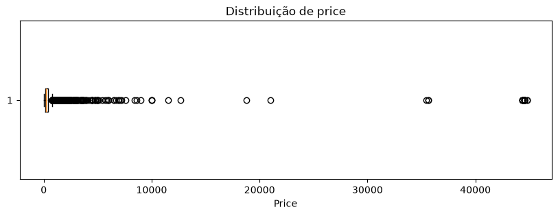
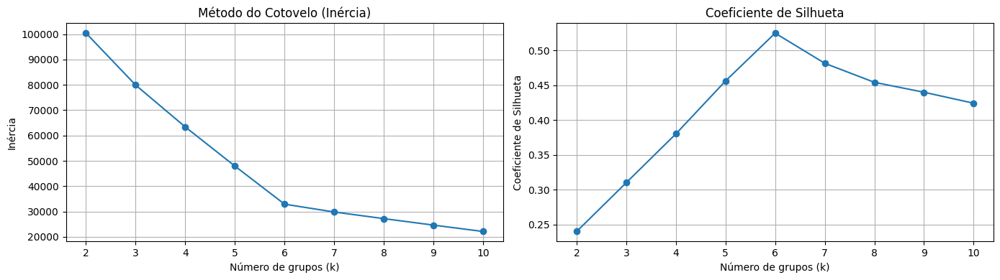
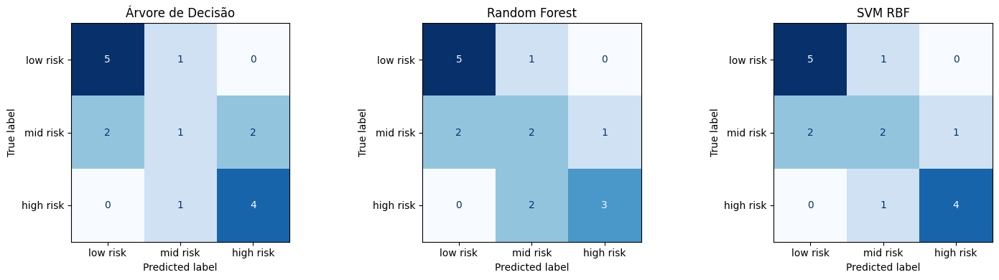

# Mineração de Dados — Portfólio Acadêmico

Coleção de trabalhos desenvolvidos no **Mestrado em Ciência da Computação (PPGCC/UFJF)**, organizados por tipo de problema de Mineração de Dados.

O repositório reúne notebooks executados, interpretação dos resultados e decisões metodológicas tomadas ao longo da disciplina, com foco em **qualidade dos dados, reprodutibilidade, avaliação adequada e prevenção de data leakage**.

## Visão visual dos experimentos

As figuras abaixo foram **extraídas das saídas originais dos notebooks deste repositório**. Representam análises efetivamente documentadas, não exemplos ilustrativos.

| Preparação e análise exploratória | Agrupamento |
| :---: | :---: |
|  |  |
| Investigação de valores extremos antes de decidir tratamentos. | Comparação visual dos resultados de agrupamento e critérios de seleção. |

### Classificação multiclasse — risco materno



**Como interpretar:** as matrizes mostram acertos e confusões entre classes de risco para os modelos comparados. A interpretação deve considerar especialmente a identificação da classe de alto risco e o tamanho reduzido da amostra: o exercício é metodológico e não fornece ferramenta de diagnóstico clínico.

[Explorar os cinco notebooks](#projetos) · [Consultar fontes e condições de uso](DATA_SOURCES.md)

## Projetos

### 1. Pré-processamento e Análise Exploratória
**Base:** aluguéis da Nova Zelândia  
**Notebook:** `01_pre_processamento_eda/trabalho_02_nova_zelandia.ipynb`

Principais tópicos:
- auditoria estrutural da base;
- tipos de dados e inconsistências;
- valores ausentes;
- outliers e anomalias;
- estatística descritiva e visualizações;
- preparação para modelagem sem vazamento.

Resultado de destaque: base final com **22.603 registros**, após investigação de inconsistências estruturais e tratamento fundamentado de ausências e anomalias.

---

### 2. Agrupamento
**Base:** produção agrícola de arroz  
**Notebook:** `02_agrupamento/trabalho_03_agrupamento.ipynb`

Principais tópicos:
- K-Means;
- agrupamento hierárquico;
- padronização;
- método do cotovelo;
- Silhouette;
- comparação externa por ARI;
- interpretação dos clusters.

Resultado de destaque: melhor configuração com **6 clusters**, Silhouette aproximada de **0,5249** e ARI **1,0** entre os dois métodos comparados. A análise também discute o risco de o agrupamento apenas reproduzir uma estrutura já explícita nos dados.

---

### 3. Regras de Associação
**Base:** cesta de compras  
**Notebook:** `03_regras_associacao/trabalho_04_regras_associacao.ipynb`

Principais tópicos:
- transformação para matriz transacional binária;
- Apriori;
- FP-Growth;
- suporte;
- confiança;
- lift;
- filtragem e interpretação de regras.

Resultado de destaque: **3.882 transações**, **132 produtos**, **122 itemsets frequentes** e **26 regras finais** após filtros de suporte, confiança e lift.

---

### 4. Classificação
**Base:** risco materno  
**Notebook:** `04_classificacao/trabalho_05_classificacao.ipynb`

Principais tópicos:
- classificação multiclasse;
- análise da distribuição das classes;
- divisão treino/teste estratificada;
- validação cruzada;
- Decision Tree;
- Random Forest;
- SVM com kernel RBF;
- F1 macro, recall e matriz de confusão.

Resultado de destaque: SVM RBF com **F1 macro de aproximadamente 0,671** no teste e **recall de 0,80 para a classe de alto risco**, com limitações explicitadas devido ao tamanho reduzido da amostra.

---

### 5. Regressão e Séries Temporais
**Problema:** previsão da volatilidade futura da PETR4  
**Notebook:** `05_regressao/trabalho_07_petr4_brent.ipynb`

Principais tópicos:
- séries temporais financeiras;
- construção de alvo futuro;
- baseline histórico;
- regressão;
- PETR4 + Brent;
- validação Walk-Forward;
- MAE, RMSE, R² e viés;
- controle explícito de vazamento temporal.

Resultado de destaque: a regressão com atributos da PETR4 superou o baseline em RMSE na maior parte dos anos analisados, enquanto o Brent não apresentou ganho incremental consistente na especificação testada.

---

## Estrutura do repositório

```text
Mineracao-de-Dados/
├── 01_pre_processamento_eda/
│   └── trabalho_02_nova_zelandia.ipynb
├── 02_agrupamento/
│   └── trabalho_03_agrupamento.ipynb
├── 03_regras_associacao/
│   └── trabalho_04_regras_associacao.ipynb
├── 04_classificacao/
│   └── trabalho_05_classificacao.ipynb
├── 05_regressao/
│   └── trabalho_07_petr4_brent.ipynb
└── README.md
```


## Dados e reprodução

Os notebooks utilizam **caminhos relativos à pasta de cada trabalho**, sem dependência de montagem do Google Drive/Colab. Para execução local, abra o notebook a partir da respectiva pasta (não da raiz do repositório). A reprodução exata depende da versão dos dados e das fontes de aquisição.

| Projeto | Dados | Disponibilidade |
|---|---|---|
| Pré-processamento / Nova Zelândia | Inside Airbnb — New Zealand | `data/4_New-Zealand.csv` original incluído (25.006 registros); integridade verificada por SHA-256 |
| Agrupamento | `trabalho3_dados_4.csv` | Incluído no repositório — 2.091 registros |
| Regras de associação | `trabalho4_dados_4.csv` | Incluído no repositório — 3.882 transações |
| Classificação | `maternal_health_risk_subbase_4.csv` | Incluído no repositório — 92 registros |
| Regressão PETR4 | PETR4/brapi + Brent e OVX/FRED | Aquisição automática pelo notebook |

Para verificar estrutura, sintaxe Python básica e existência dos CSV locais sem executar os modelos:

```bash
python tools/auditar_portfolio.py
```

A auditoria também é executada automaticamente por GitHub Actions a cada push ou pull request. **Ela não substitui a execução ponta a ponta dos notebooks.** Consulte [proveniência e limitações de redistribuição](DATA_SOURCES.md).

### Padrão dos notebooks

Todos os notebooks seguem a mesma lógica de apresentação:

**introdução → objetivo → dados → preparação → análise exploratória → método → resultados → visualizações → interpretação → limitações → conclusão**

As visualizações são escolhidas conforme o problema:

- histogramas e boxplots para distribuições e valores extremos;
- gráficos de dispersão e correlação para relações numéricas;
- método do cotovelo e Silhouette para agrupamento;
- suporte, confiança e lift para regras de associação;
- matriz de confusão e importância de atributos para classificação;
- RMSE por período, estabilidade temporal e comparação com baseline para regressão.

## Princípios metodológicos

- compreender o problema antes de escolher o algoritmo;
- investigar dados ausentes e outliers antes de removê-los;
- separar desenvolvimento e avaliação;
- ajustar transformações somente com dados de treino;
- respeitar ordem temporal em séries;
- comparar modelos com baselines;
- distinguir associação de causalidade;
- registrar limitações e decisões metodológicas;
- priorizar soluções simples, reproduzíveis e verificáveis.

## Tecnologias

`Python` · `Pandas` · `NumPy` · `Scikit-learn` · `Matplotlib` · `Jupyter Notebook` · `MLxtend`

---

**Autor:** Álvaro Bonifácio  
Mestrando em Ciência da Computação — Inteligência Computacional — UFJF

### Integridade da base da Nova Zelândia

O arquivo original `4_New-Zealand.csv` (25.006 registros × 16 colunas) foi recuperado e identificado pelo SHA-256 `2284f8d6c9a45069fecee324c158eda49f6cf02791496ecdded101d35b174c20`. O notebook verifica automaticamente o hash ao usar o arquivo local. **O CSV original está publicado** em `01_pre_processamento_eda/data/`. O download permanece opção secundária.
